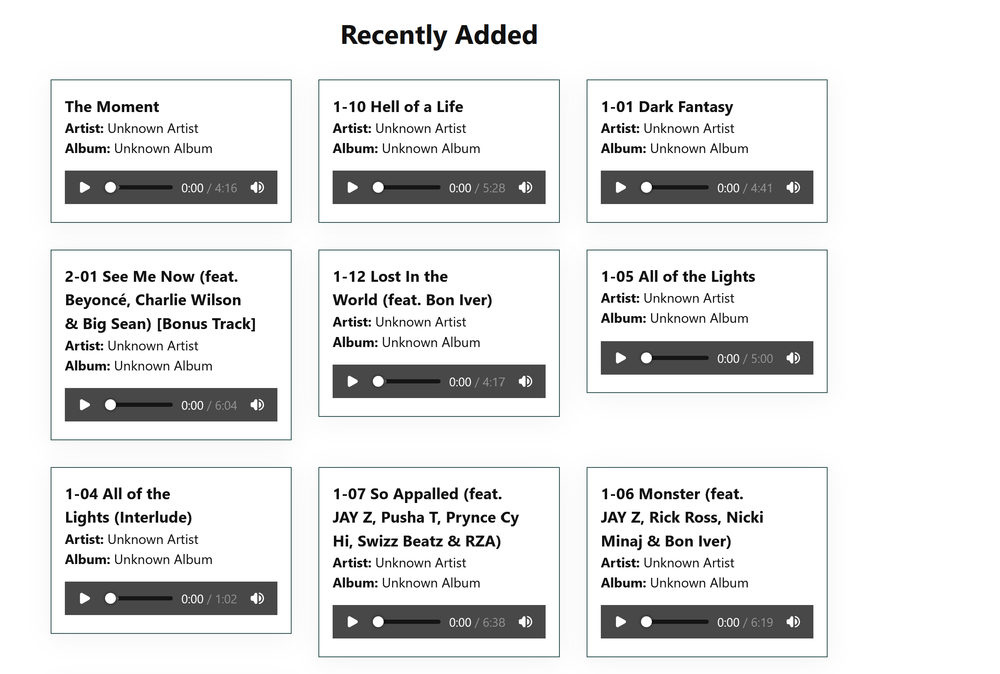
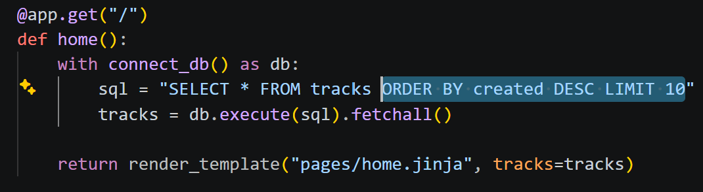

# Sprint 2 - Implement Database and Display of Test Data

## Sprint Goals

Implement the database, populated with test data. Create queries that retrieve test data, and display this on web pages as needed. Test and refine the queries and data display, so that it stands as the basis of the next sprint.

### Specific Goals

**Edit these goals as needed**

- Implement the SQLite database schema (`tracks`, `playlists`, `playlist_tracks`)
- Add test music to the database
- Create the following web pages:
    - Home page showing recent tracks
    - Library page showing all tracks and playlists
    - Search page
- Develop SQL database queries to:
    - Retrieve recent tracks
    - Retrieve all library tracks sorted by artist name and song name
    - Retrieve playlists and filtered search results

## Testing Database Connection and Home Page display

Tested if the app could successfully connect to the SQLite database and fetch the 10 most recently added tracks to display on the home screen

**PLACE SCREENSHOTS AND/OR ANIMATED GIFS OF THE TESTING HERE**

### Changes / Improvements

Tracks were showing up in random order. Added `ORDER BY created DESC` to the SQL query so the newest music always appears at the top.

**PLACE SCREENSHOTS AND/OR ANIMATED GIFS OF THE IMPROVED SYSTEM HERE**

## Testing Library Page Display tracks and playlists

Tested that all songs and playists show up in libary page 

**PLACE SCREENSHOTS AND/OR ANIMATED GIFS OF THE TESTING HERE** 

### Changes / Improvements

Sorted the tracks by artist name first, then song title, so the library looks organized

**PLACE SCREENSHOTS AND/OR ANIMATED GIFS OF THE IMPROVED SYSTEM HERE**

## Testing FEATURE NAME HERE

Replace this text with notes about what you are testing, how you tested it, and the outcome of the testing

**PLACE SCREENSHOTS AND/OR ANIMATED GIFS OF THE TESTING HERE**

### Changes / Improvements

Replace this text with notes any improvements you made as a result of the testing.

**PLACE SCREENSHOTS AND/OR ANIMATED GIFS OF THE IMPROVED SYSTEM HERE**

## ETC...

## Sprint Review

I think this sprint went alright. I manged to get the app in a half working state, the app lets you upload music, play music and also make playlists. I think that making it all work has hard and it took me a while to get it working but in the end it works but could be better.