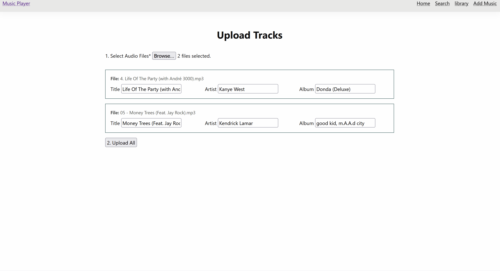
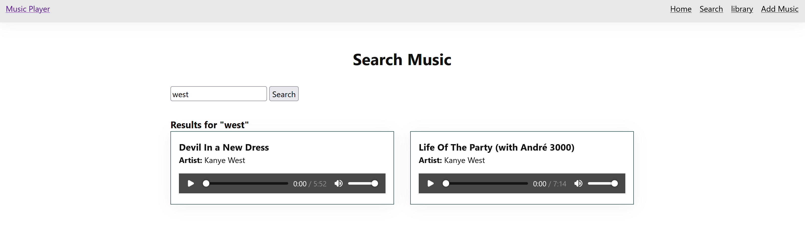

# Sprint 3 - Developing a Minimum Viable Product (MVP)

## Sprint Goals

Continue to develop the web application to the point that it provides all key functionality of the system. Test and refine it so that it can serve as the basis for the final phase of development.

### Specific Goals

**Edit these goals as needed**

- Create the following web pages:
    - Upload form (`/upload`) Need support for common audio file formats
    - New playlist form (`/playlist/new`)
    - playlist detail view (`/playlist/<id>`)
    Search page (`/search`)
- Develop SQL database queries to:
    - Insert uploaded tracks and handle file storage paths
    - Insert new playlists and link tracks
    - Search tracks using `LIKE` filters across title, artist, and album

## Testing Multi-File Upload Feature

Tested uploading multiple audio files at once to the app to make sure the app can sort multiple audio files at once

**PLACE SCREENSHOTS AND/OR ANIMATED GIFS OF THE TESTING HERE**

### Changes / Improvements

Added `secure_filename` and unique UUID prefixes to uploaded files to prevent errors when users upload files with duplicate names

**PLACE SCREENSHOTS AND/OR ANIMATED GIFS OF THE IMPROVED SYSTEM HERE**

## Testing Search Functionality

Tested entering keywords into the search bar to check if SQL `LIKE` queries accurately filter songs by title, artist, or album

**PLACE SCREENSHOTS AND/OR ANIMATED GIFS OF THE TESTING HERE**

### Changes / Improvements

Added `.strip()` and lowercase handling to search queries so accidental spaces don't break search result

**PLACE SCREENSHOTS AND/OR ANIMATED GIFS OF THE IMPROVED SYSTEM HERE**

## Testing FEATURE NAME HERE

Replace this text with notes about what you are testing, how you tested it, and the outcome of the testing

**PLACE SCREENSHOTS AND/OR ANIMATED GIFS OF THE TESTING HERE**

### Changes / Improvements

Replace this text with notes any improvements you made as a result of the testing.

**PLACE SCREENSHOTS AND/OR ANIMATED GIFS OF THE IMPROVED SYSTEM HERE**

## ETC...

## Sprint Review

I think this sprint has been the best so far. While working on this sprint I have found and fixed lots of parts of the website such as when uploading tracks to the app they would always say it was by "Unknown Artist". I also added things such as a way to delete tracks and playlists from the app. I think I still need to work on the UI of the app as I don't really like how bland it looks and also when working on the app at night time I always get blinded by the white background, I think I could like to make the app more darker and I would also like to add some blur effects to things cause I think it could make the app look more clean and good.
