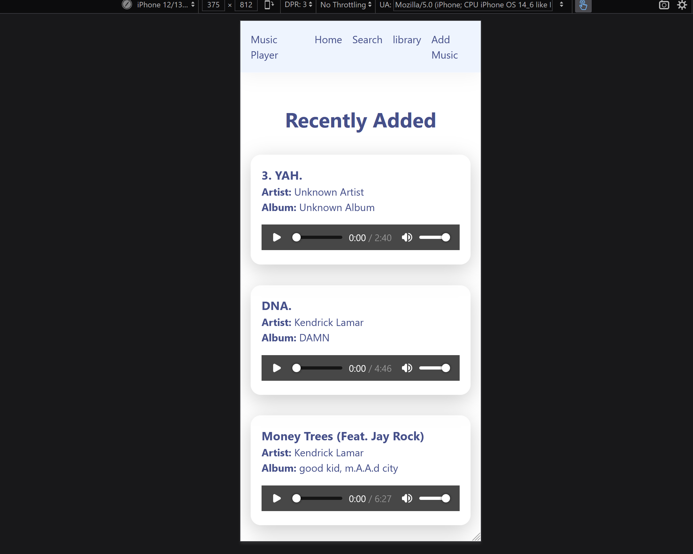
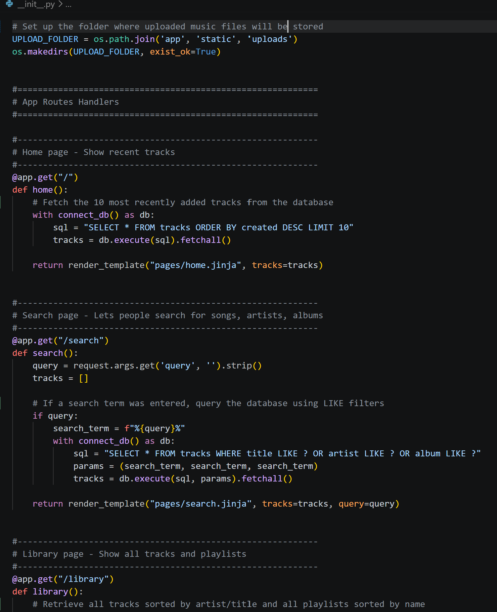
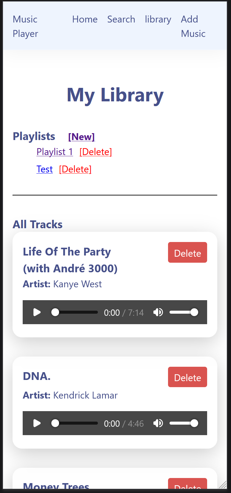
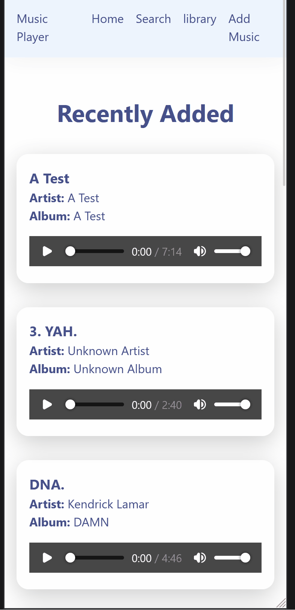
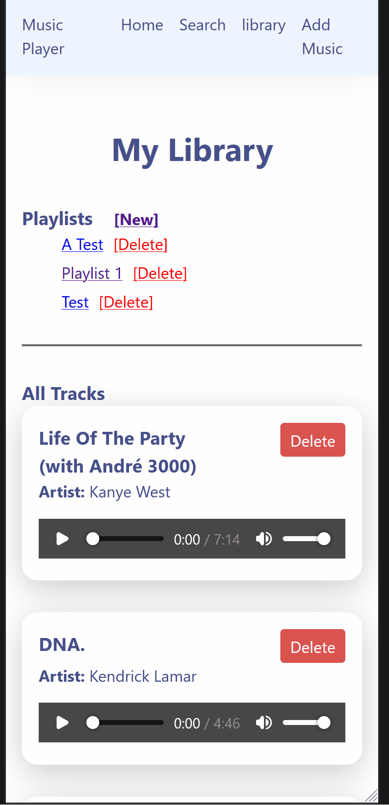

# Sprint 4 - Developing a Refined and Complete System

## Sprint Goals

Develop the system until it is fully featured, with a refined UI and it satisfies the requirements. The system will be fully tested at this point.

In this sprint I would like to mainly focus on the UI of the website/App as its in as I think it looks ugly

### Specific Goals

**Edit these goals as needed**

- Refine the design and UI of the website
- Refine the user experience (UX) of the system
- Perform final, full-system testing

## Tested background frost effect

Tested implementing the frosted glass blur effect (`backdrop-filter: blur`) in the CSS to give the app a modern appearance

**PLACE SCREENSHOTS AND/OR ANIMATED GIFS OF THE TESTING HERE**

### Changes / Improvements

I managed to get the frosted glass effect working, but I decided to keep the white background because I started to like how it looked. Because of the white background, the frosted glass blur effect doesn't show up as well, but the overall layout looks much cleaner and simpler

**PLACE SCREENSHOTS AND/OR ANIMATED GIFS OF THE IMPROVED SYSTEM HERE**

## Testing Code Comments and Organization

Tested and reviewed the Python code to ensure all routes and database queries are properly documented with comments

**PLACE SCREENSHOTS AND/OR ANIMATED GIFS OF THE TESTING HERE**

### Changes / Improvements

The Code is now easier to understand and is easier to find certin parts of the code.

**PLACE SCREENSHOTS AND/OR ANIMATED GIFS OF THE IMPROVED SYSTEM HERE**

## Testing Music Deletion

Testing if music/playlist Deletion from the libary works without problems

**PLACE SCREENSHOTS AND/OR ANIMATED GIFS OF THE TESTING HERE**

### Changes / Improvements

**PLACE SCREENSHOTS AND/OR ANIMATED GIFS OF THE IMPROVED SYSTEM HERE**

## ETC...

## Sprint Review

I think sprint 4 went well. I thought the UI needed a lot of inprovment but after changing the color of the text and some of the other things I started to like how it looked simple and didnt look bloated. Having the frosted blur look would look cool but I wanted my app/website to look simple.
